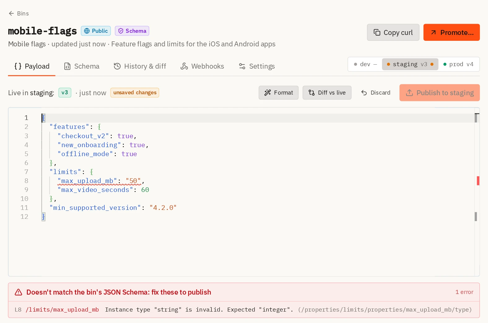

<p align="center">
  <a href="https://hotcfg.run">
    
  </a>
</p>

<h1 align="center">You can't push broken config.</h1>

<p align="center">
  Remote JSON config for mobile, web and desktop apps.<br>
  Versioned config with a schema that refuses bad pushes, staging before production, one-click rollback, and unlimited reads from the edge.
</p>

<p align="center">
  <a href="https://hotcfg.run"></a>
  <a href="https://hotcfg.run/docs"></a>
  <a href="https://github.com/hotcfg/cli/releases/latest"></a>
  <a href="https://github.com/marketplace/actions/hotcfg"></a>
  <a href="https://status.hotcfg.run"></a>
</p>

<p align="center">
  <a href="https://hotcfg.run">
    <picture>
      <source media="(prefers-color-scheme: dark)" srcset="refuse-dark.webp">
      
    </picture>
  </a>
</p>

---

[hotcfg.run](https://hotcfg.run) serves JSON config to your apps from the edge: feature flags, kill switches, limits, minimum versions. Every bin can carry a JSON Schema, and a push that doesn't match it is refused, in the dashboard, the CLI and CI, before it reaches a single device.

- **Schema-checked pushes.** Errors point at the line and the rule, so a typo never ships.
- **Environments.** Development, staging and production, with promote between them, to everyone or to a share of readers first.
- **History and rollback.** Every version is kept with who pushed it; diff any two and roll back in one click.
- **Typed config.** Generate TypeScript, Swift, Kotlin, Java, Python, PHP, Ruby, Go, GDScript or C# types from a bin's schema.

## Repositories

| Repository | What it is |
| --- | --- |
| [**cli**](https://github.com/hotcfg/cli) | The `hotcfg` command-line tool: push, validate, diff, promote (now or on a schedule), roll back and generate types. |
| [**action**](https://github.com/hotcfg/action) | GitHub Action that checks config on every pull request and pushes it on merge. |
| [**homebrew-tap**](https://github.com/hotcfg/homebrew-tap) | Homebrew cask for the CLI. |
| [**status**](https://github.com/hotcfg/status) | Uptime monitoring and incident history, live at [status.hotcfg.run](https://status.hotcfg.run). |

## Get started

```sh
brew install --cask hotcfg/tap/hotcfg
hotcfg login
hotcfg push flags.json --bin mobile-flags --env staging
```

Read config from any app with a plain HTTPS request. See the [quickstart](https://hotcfg.run/docs/quickstart), the [CI guide](https://hotcfg.run/docs/guides/ci) and [pricing](https://hotcfg.run/pricing).
